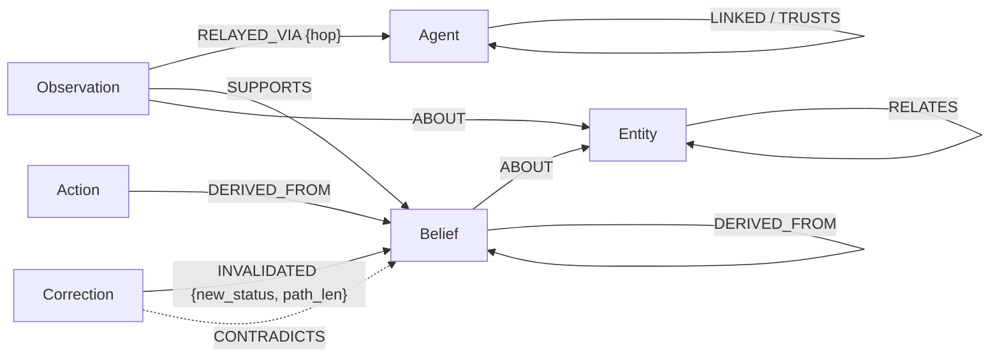

# Groundwork

Teams of AI agents whose only memory is a shared belief graph. Every belief records what it rests
on, so one correction reaches exactly what was built on it, and whoever said something false stops
being trusted. Live at https://groundwork-agents.fly.dev.

<br clear="left" />

Under it is a domain-agnostic graph layer (this package, `graph-agent`) and a benchmark game, Ring
Fire, that runs the same agents on two backends: a graph store (FalkorDB) and a relational store
(PostgreSQL).

The project notes live in the Obsidian vault, reached through the
`docs` symlink in this folder (not tracked by git).

**Try it:** open https://groundwork-agents.fly.dev, sign in with Google, open **Fire sim** and run
it on the **Scripted stand-in** (free, no key needed). Press Play and watch the false alarm spread
around the ring and then get caught. Press **Why** on any belief to see the graph path behind it.

## The graph

Each agent has nothing but its part of one FalkorDB graph to remember with. Each run gets its own
graph (`space_<id>`). The node types and relationships are in `src/graph_agent/core/model.py`, and
every query is in `src/graph_agent/stores/falkor.py`.



| Node | What it is |
|---|---|
| **Agent** | A team member, or an outside source such as a mail sender or a Bluesky poster |
| **Observation** | One thing an agent received: a sensor reading, a feed item, a message from a teammate. Its `RELAYED_VIA` edges record every agent it passed through, hop by hop. |
| **Belief** | A claim the agent holds (subject, predicate, value), with an origin (observed, told or derived) and a status (active, suspect, stale or retracted) |
| **Entity** | What beliefs are about: a field, a quake, a person, a trip |
| **Action** | Something the agent committed to (water a field, book a trip), linked to the beliefs it relies on |
| **Correction** | An exposure, a retraction or a reinstatement. Its `INVALIDATED` edges record exactly which beliefs it changed. |

### How the agents query it

The agents read and write the graph only through tools (`src/graph_agent/core/tools.py`):
`recall`, `explain`, `traverse`, `shortest_path`, `assert_belief`, `retract`, `send` and `act`.
These are the queries that do the work:

```cypher
// Where a belief came from: every supporting observation, with the route it took
MATCH (o:Observation)-[:SUPPORTS]->(b:Belief {id: $id})
OPTIONAL MATCH (o)-[r:RELAYED_VIA]->(a:Agent)
RETURN o.id, collect([r.hop, a.id])

// What rests on it: walk DERIVED_FROM backwards, one level per query (breadth-first)
MATCH (s:Node)<-[:DERIVED_FROM]-(d)
WHERE s.id IN $frontier AND d.owner = $viewer
RETURN DISTINCT d.id, labels(d), d.status

// A liar exposed: recount each belief's routes that avoid every exposed agent
MATCH (b:Belief {owner: $viewer}) WHERE b.status IN ['active', 'suspect']
MATCH (o:Observation)-[:SUPPORTS]->(b)
OPTIONAL MATCH (o)-[:RELAYED_VIA]->(a:Agent)
WITH b, o, collect(a.id) AS route
WITH b, sum(CASE WHEN size([x IN route WHERE x IN $exposed]) = 0 THEN 1 ELSE 0 END) AS alive
SET b.support_routes = alive

// Write the outcome, with the correction that caused it
UNWIND $changes AS ch
MATCH (c:Node {id: $cid}), (b:Node {id: ch.id})
SET b.status = ch.status
CREATE (c)-[:INVALIDATED {new_status: ch.status, path_len: ch.path_len}]->(b)
```

### Where the decisions come from the graph

- **What to trust.** When the checker refutes a claim, it blames the first agent on that claim's
  `RELAYED_VIA` route: the one who made it up, not the honest teammates who passed it on. That
  agent is exposed, and any belief left with no route around them turns **stale**.
- **What to redo.** A belief that goes stale or is retracted turns everything built on it
  (`DERIVED_FROM`, any depth) **suspect**. That includes actions, so the offsite's Actions desk
  rebooks exactly the trips that relied on the old date and leaves the agenda alone.
- **What to say.** Agents pass on a belief with `send`. The receiver gets a new Observation whose
  route is one hop longer, so a lie can always be traced back to where it started.
- **What to forgive.** When an agent is trusted again, a stale belief comes back if one of its
  routes now avoids everyone still exposed. A suspect belief comes back once everything it was
  derived from is active again.
- **The comparison.** Ring Fire runs the same agents on a relational store (PostgreSQL) as well,
  and the offsite has a shared-notes baseline. With shared notes, nothing tells an agent what
  rested on a fact that changed.

## Layout

The main project is generic. Domains are packs on top of it; Ring Fire (the benchmark game) is one
pack, loaded into the console like any other.

| Path | Purpose | May import |
|---|---|---|
| `src/graph_agent/core/` | The belief graph: nodes, edges, store interface, context compiler, graph tools | itself only |
| `src/graph_agent/stores/` | In-memory, FalkorDB and PostgreSQL stores | core |
| `src/graph_agent/harness/` | Model client and cache, one agent turn, run trace | core |
| `src/graph_agent/frame/` | A team of nodes (triggers, a model or code handler, own tools, graph tools), the runtime, MCP client, what a pack gives the console | core, harness |
| `src/graph_agent/service/` | HTTP API with a live event stream, and the list of packs the page offers | everything above |
| `src/graph_agent/packs/ringfire/` | The fire game: `sim/` engine, `adapter.py`, `benchmark/` (original loop, baselines, scoring), `pack.py` (on the frame), `viewer/` | core, stores, harness, frame |
| `src/graph_agent/packs/life/` | Mail, calendar, travel, promises, money: a simulated week, tools, teams, MCP server | core, stores, harness, frame |
| `src/graph_agent/packs/hualien/` | The Hualien earthquake adapter (real data, second domain) | core |
| `src/graph_agent/packs/apps/` | Your own agents on your own apps: a few lines per agent, any MCP server per app | core, stores, harness, frame |
| `viewer/console/` | The page: build a team on a canvas, run it, see why | n/a |
| `benchmarks/` | Run scripts: `ringfire/`, `life/`, and the store micro-benchmark | n/a |
| `tests/` | Tests: shared at the top, per pack in `ringfire/`, `life/`, `hualien/` | n/a |

To add a pack: a folder under `packs/` that implements `frame/console.py:ConsolePack`, listed in
`service/registry.py`. `tests/test_architecture.py` enforces the import rules, keeps domain words
out of the generic packages, keeps packs from importing each other and keeps `ringfire/sim` free of
imports.

## Setup

Requirements: Docker with Compose, and [uv](https://docs.astral.sh/uv/).

```bash
uv sync                      # installs Python 3.12 and dependencies
docker compose up -d --wait  # FalkorDB and PostgreSQL
uv run pytest                # all tests
uv run pytest -m "not integration"   # without the databases
uv run ruff check .
```

Services (bound to 127.0.0.1, off the default ports):

| Service | Port | Notes |
|---|---|---|
| FalkorDB | 16379 | Redis protocol. Browser UI at http://127.0.0.1:13000 |
| PostgreSQL | 15432 | user `postgres`, password `postgres`, database `graph_agent` (local only) |

Override with `FALKORDB_HOST`, `FALKORDB_PORT` and `POSTGRES_DSN`.

## The frame, the use cases and the console

```bash
uv sync --extra service                      # FastAPI, uvicorn and the MCP SDK
(cd viewer/console && npm install && npm run build)
uv run python -m graph_agent.service         # the console at http://127.0.0.1:8765
uv run python benchmarks/ringfire/frame_pilot.py --provider anthropic --systems frame-memory ...
uv run python benchmarks/life/run.py --provider anthropic --cases travel promises money week
uv run python -m graph_agent.packs.life.mcp_server   # the simulated services as an MCP server
```

Ring Fire on the frame plays exactly the game of `harness/game.py` (`tests/test_frame_ringfire.py`
compares the logs event for event), so the two share a model cache.

## Your real accounts (read-only mail, Todoist)

The life pack's "Real mailbox" team reads your Gmail and Calendar and plans Todoist tasks from
promises in your mail. It uses ready-made MCP servers ([workspace-mcp] for Google, Doist's
`@doist/todoist-mcp` for Todoist); we wrote no connectors. Mail and calendar are read-only, and
Todoist writes are only recorded ("shadow") unless you choose otherwise.

```
# .env (values are never printed)
GOOGLE_OAUTH_CLIENT_ID=...        # also read as GOOGLE_CLIENT_API
GOOGLE_OAUTH_CLIENT_SECRET=...    # also read as GOOGLE_CLIENT_SECRET
USER_GOOGLE_EMAIL=you@gmail.com
TODOIST_API_KEY=...
uv run python -m graph_agent.packs.life.real auth   # once: prints a link, you sign in
```
Then pick "Real mailbox" in the console, leave "Outward actions" on "Record only", press Step.

## Your own agents on your own apps

Open the console's **My apps** page. In four steps:

1. **Your apps.** Add Gmail and Calendar or Todoist from a preset, or any MCP server (a command
   to start, or a URL). Press **Test**: it starts the server, lists its tools (which ones only read,
   which ask you first) and reads each feed once, showing a sign-in link if the server wants one.
   Secrets never go in the page: an app names them (`$TODOIST_API_KEY`) and you put the values in
   `.env`. Saved to `connections.json` (git-ignored).
2. **Live data.** Streams of public data that need no account: quakes (USGS, EMSC, Japan's agency),
   disaster and weather alerts, flood warnings, status pages, security advisories, Bluesky posts,
   Wikipedia edits, news (18 in all, `packs/apps/public_streams.py`), or any page, websocket or
   event stream you describe by its paths (`frame/streams.py`). Each gets filters of yours (a field
   and a regex) and **Peek** shows what the team would read. An agency's record is evidence; a post
   is a claim from a poster who can be caught lying. A team with streams reads them every 30
   seconds, for 24 polls unless you say otherwise.
3. **Your agents.** Each one is a name, its job in your words, the kinds of thing it looks after
   (events, promises, bills, your own kinds) and the app tools it may use. Tick "carries out" for
   an agent that acts on the team's plans: it reads no mail. Problems are named as you type. You
   can keep several teams on the same apps: **+ New team** on top starts one (blank, or from an
   example: your mail and tasks, or a quake desk on live data alone), and each is saved to `my-teams/<team>.json` (git-ignored); the streams, router,
   checker, links and safety settings are made from it (`packs/apps/setup.py`).
4. **Run it** with a real model, outward actions on "Record only" to start.

Without the page: `uv run python -m graph_agent.packs.apps.run example` writes both files to start
from, and `... apps.run check [team]` connects each app, lists its tools and checks the teams (free: no
model is called). The page only writes files or starts servers for requests from itself on
127.0.0.1.

## Deploying it for other people

The same console can be hosted for others. Each person signs in with Google, brings their own
Anthropic key, and connects their own Gmail and Calendar (read-only) and apps. Setting
`GRAPH_AGENT_PUBLIC_URL` switches this on; without it the console stays local, as above.

- **Accounts:** `service/users.py` and `service/auth.py`. A session is a signed cookie. Each
  person has a folder on the volume (`/data/users/<google id>`) holding their encrypted keys,
  apps, teams and model cache. Their runs are theirs alone; others get 404.
- **Gmail and Calendar:** one shared workspace-mcp runs beside the service, in its mode for
  several people. Each request carries that person's own Google access token, made from the
  refresh token kept when they pressed "Connect Gmail and Calendar".
- **The graph:** FalkorDB runs in the same container, on that machine only. The image is built on
  the pinned FalkorDB image the tests use. A hosted run's graph is dropped with the run, so
  nothing of it is written to disk.
- **Safety:** people may add only the presets, or apps that are public `https` servers. Nobody
  starts a command on the server, and a started server never sees the server's own secrets.
  Each person keeps 3 runs and plays one at a time. "Delete my account" removes everything.

**Where:** not Vercel. Runs live in memory on threads, the page follows them over a stream, and
MCP servers are child processes. That needs one always-on container with a disk. `fly.toml` is for
[Fly.io](https://fly.io) (Railway or Render work the same way, from the `Dockerfile`). Keep it to
one machine: runs live in that machine's memory.

**Google Cloud, once** (in the project of your OAuth client):

1. APIs: enable the Gmail API and the Google Calendar API.
2. Credentials: create an OAuth client of type **Web application**, with the authorized redirect
   URI `https://<your app>.fly.dev/auth/callback`.
3. OAuth consent screen (Branding / Audience / Data access): add the scopes `openid`, `email`,
   `profile`, `gmail.readonly` and `calendar.readonly`, set the home page to your URL and the
   privacy policy to `<your URL>/privacy`.
4. While the app is in **Testing**, only the test users you add (at most 100) can connect, and
   their Google sign-in lasts 7 days. Opening it to anyone needs Google's verification.
   `gmail.readonly` is a *restricted* scope, which also needs a yearly security assessment by
   a third party (CASA).

**Fly.io:**

```bash
fly launch --no-deploy --copy-config      # pick an app name; then set it as `app` in fly.toml
fly volumes create groundwork_data --size 1
fly secrets set GRAPH_AGENT_PUBLIC_URL=https://<your app>.fly.dev \
    SECRET_KEY="$(openssl rand -base64 48)" \
    GOOGLE_OAUTH_CLIENT_ID=... GOOGLE_OAUTH_CLIENT_SECRET=... \
    GRAPH_AGENT_CONTACT=you@example.com
fly deploy
fly scale count 1
```

**Then on every push:** `.github/workflows/deploy.yml` tests each push to `master` (the Python
tests against the same pinned services, the page's types and tests) and, when all pass, deploys
it with Fly's own builder. Give it a deploy token once:

```bash
fly tokens create deploy | gh secret set FLY_API_TOKEN
```

`SECRET_KEY` signs the sessions and encrypts everyone's keys. If it changes, everyone must sign
in again and add their keys again. Recorded runs (`runs/`) are not in the image: that folder is
your own model cache, and its apps entries hold your real mail.

[workspace-mcp]: https://github.com/taylorwilsdon/google_workspace_mcp
